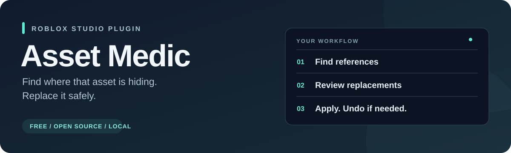

<div align="center">



[](https://github.com/Zackslay/asset-medic/actions/workflows/ci.yml)
[](https://github.com/Zackslay/asset-medic/releases/tag/v0.1.0)
[](LICENSE)
[](https://discord.gg/4cxQwKtY3q)

**A free Roblox Studio plugin for finding and replacing asset references.**

[**Download the plugin**](https://github.com/Zackslay/asset-medic/releases/download/v0.1.0/AssetMedic-0.1.0.rbxmx) · [**Join Discord**](https://discord.gg/4cxQwKtY3q) · [**Report a bug**](https://github.com/Zackslay/asset-medic/issues)

</div>

---

Paste an asset ID, Roblox URL, or Output error. Asset Medic finds matching objects and script lines, lets you review selected replacements, and groups successful property edits into one Studio undo operation.

No account, backend, HTTP access, or AI subscription needed.

> [!NOTE]
> **Public beta.** Start on a saved copy of your place. The Creator Store listing is not published yet. See [tested behavior and remaining checks](docs/VALIDATION.md).

## What it does

| Find it | Review it | Replace it |
| --- | --- | --- |
| Search a whole place or a selection. | Filter results and choose exactly what changes. | Apply selected property edits as one undo operation. |
| Browse an inventory of supported asset references. | Inspect full old and new values before applying. | Skip changed or deleted targets and report failures. |
| Jump to objects and readable script lines. | Keep script text and protected mesh geometry read-only. | Undo the batch using Studio's **Edit → Undo**. |

## Get started

1. [Download **AssetMedic-0.1.0.rbxmx**](https://github.com/Zackslay/asset-medic/releases/download/v0.1.0/AssetMedic-0.1.0.rbxmx), or build it from source below.
2. In a disposable Studio place, insert the `.rbxmx` file through **Insert from File** in Explorer. This creates an `AssetMedic` Script with child modules.
3. Right-click the root Script and choose **Save / Export → Save as Local Plugin**. Leave the root Script enabled when saving the plugin, then remove the inserted Script from the place. Do not leave the plugin source as a game script.
4. Open a fresh Studio instance, then **Plugins → Asset Medic**. If Studio requests script access, allow it to enable read-only script searching. No network access is needed.

## Find → preview → apply

1. Paste the ID, URL, or error and click **Find references**. Multiple IDs produce a choice list.
2. Choose **Whole place** or **Selection** before scanning. Selection includes selected objects and descendants; an empty selection never falls back to the whole place.
3. Click **Select** to locate an object in Explorer, or **Code** to open a script line. Script matches are textual, including comments and unrelated numeric literals; they are not proof of executable asset usage.
4. Filter by ID, path, property, or category. Check writable rows, enter the replacement ID, and click **Preview**. Only checked rows in the current filter enter the preview.
5. Review old and new values, then click **Apply reviewed changes**. Use Studio Undo/Redo to reverse/reapply the successful batch. Changed or deleted targets are skipped and reported.

**Inventory** lists recognized object-property references, grouped by asset ID. It does not treat every number in scripts as an asset. Inventory rows start unchecked. **Toggle all filtered** deliberately selects or clears the filtered writable references.

Scans run on demand, yield periodically, and can be cancelled. Results are paginated to bound UI object count. Closing the panel cancels scanning and releases result references.

## Asset coverage

Audio, animations, images, effects, meshes, and readable script references are supported through the properties below.

<details>
<summary><strong>View supported classes and properties</strong></summary>

| Class | Properties | Replacement |
| --- | --- | --- |
| Sound | SoundId | Yes |
| Animation | AnimationId | Yes |
| MeshPart | MeshId | Read-only geometry |
| MeshPart | TextureID | Yes |
| SpecialMesh | MeshId, TextureId | Yes |
| Decal and Texture | Texture | Yes |
| ImageLabel, ImageButton | Image | Yes |
| SurfaceAppearance | ColorMap, MetalnessMap, NormalMap, RoughnessMap | Yes |
| ParticleEmitter, Beam, Trail | Texture | Yes |
| Script, LocalScript, ModuleScript | Readable editor source | Search only |

Only positive numeric Roblox asset references in supported properties are indexed. Built-in `rbxasset://` paths, arbitrary external URLs, and object-backed Content values are outside v1. Whole-place scanning covers place-owned content services and excludes Studio/plugin internals.

</details>

## Limits

- Replacing an ID does not grant permissions, restore moderated assets, check asset type, or prove an asset will load.
- MeshPart geometry is protected by Roblox. Asset Medic finds its ID but does not rebuild or replace the part.
- Scripts are never edited. Dynamic/concatenated IDs and references in arbitrary attributes, configuration strings, or unsupported properties may not be found.
- Batch replacement is available only outside playtests. Property write failures are reported; successful edits remain together in the undo recording.
- Scans are snapshots. Objects edited while scanning or after preview may become stale. The apply step checks the original property value again.
- Library and catalog URLs identify the supplied ID; the plugin does not resolve container/decal IDs into different underlying asset IDs.

## For developers

<details>
<summary><strong>Build from source and run the tests</strong></summary>

Prerequisites: Node.js 22 or newer, npm, and Rojo 7.7.0 on PATH. The lockfile pins the test dependency. Node tooling is development-only; the installed plugin has no external runtime dependencies.

```sh
npm ci
npm test
npm run build
npm run build:fixture
```

Outputs: `dist/AssetMedic-0.1.0.rbxmx` and `dist/AssetMedic-TestPlace.rbxlx`.

`npm test` compiles every shipped Luau file and executes core modules in Luau via luau-web. Instance, task, and history boundaries use explicit adapters; this is not a Studio test or a static type check.

With Python 3 available, `python scripts/verify-artifact.py` verifies that the built plugin contains the exact current sources. The included GitHub Actions workflow is intended for this directory as the root of its own repository; it will not run while nested inside another repository.

For engine validation, open the generated disposable test place, stop playtesting, and run this in the Command Bar:

```lua
require(game.ServerStorage.AssetMedicStudioSpec)()
require(game.ServerStorage.AssetMedicUISpec)()
```

This checks actual supported property writes, current script text, replacement, Studio undo/redo, UI construction, and a 5,000-sound scan. It creates and cleans up a fixture, opens/closes a test script, and changes the disposable place's undo history. Unavailable test IDs can produce asset-load errors; these are expected and are not evidence of permission diagnosis. Run it from the Command Bar: Studio MCP may wrap commands in its own recording, causing the replacement's recording to be refused. Never run it against your production place. See [release checks](docs/RELEASE.md).

</details>

## Support

Join the [Discord support server](https://discord.gg/4cxQwKtY3q) for questions and troubleshooting. Found a bug? [Open an issue](https://github.com/Zackslay/asset-medic/issues) with your Studio version, reproduction steps, and expected versus actual behavior.

## Contribute

Start with a reproducible ID parsing issue or an unsupported asset property. Keep property support in `src/Properties.luau`; add a regression case before changing behavior. Explain any Studio permission requirement. Include Studio evidence for engine-dependent changes, and keep script editing outside v1.

Before opening a PR, run `npm test`, build both artifacts, and report which Studio checks you actually performed. See [CONTRIBUTING.md](CONTRIBUTING.md).

## Acknowledgments

Built by Zackslay with assistance from OpenAI's ChatGPT and Codex in planning, implementation, testing, and documentation. Asset Medic is an independent project and is not affiliated with or endorsed by OpenAI or Roblox.

## License

MIT. The repository contains no third-party Roblox assets.
